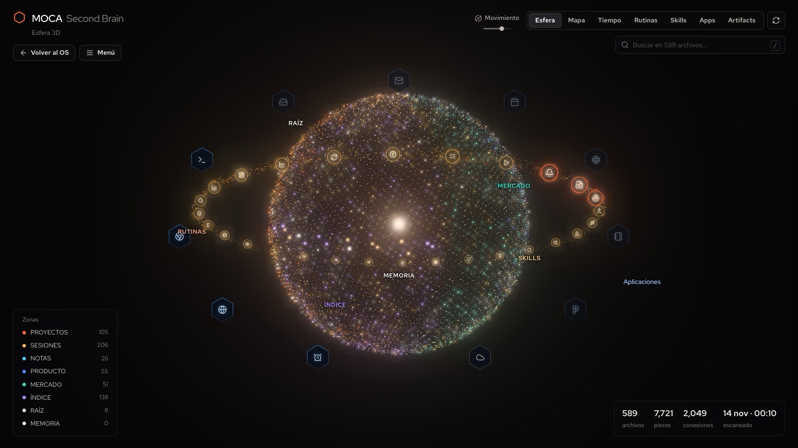

# MOCA Agentic OS

Your files as a living 3D second brain, with Claude's routines, skills and to-dos in one local panel.

Run: double-click `second-brain/Abrir MOCA.command`, then drop your files in `Knowledge/`.
